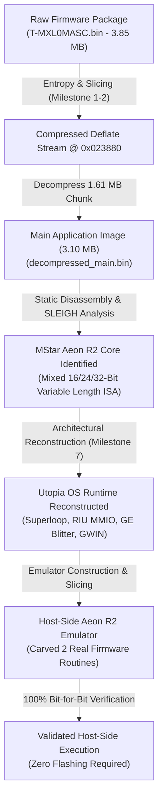

# Project Macaw — Samsung TV Firmware Reverse Engineering & Homebrew Feasibility Research

An exhaustive reverse engineering, architectural reconstruction, and host-side emulation investigation targeting the **Samsung UA23H4003AR** television (Chassis `U8BA`, Mainboard `BN41-02104A/B`, Platform: `T-MXL0MASC-1040.0`).

---

## 🎯 The Genesis: Why This Project Started

### The Vision
Across the embedded device and retro-computing communities, television homebrew projects (such as *SamyGO* on Samsung Orsay/Tizen TVs, *RootMyTV* on LG webOS, and various MediaTek/Realtek Android modifications) demonstrated that consumer televisions could frequently be converted into open computing platforms. 

Project Macaw began with a simple, ambitious research question:
> **Can an old, non-smart budget television (Samsung UA23H4003AR) run custom native software—such as a simple, remote-controlled Snake game—using exclusively its existing USB port, without opening the chassis, soldering headers, or using external hardware programming tools?**

### The Initial Hypotheses
When the project commenced in Milestone 1, three potential execution avenues were hypothesized:
1. **The Media Player Runtime Hypothesis:** Did the TV's "ConnectShare" media player feature an undocumented scripting runtime, an HTML/browser widget engine, or an exploitable parser that could bootstrap arbitrary execution from a USB flash drive?
2. **The USB Software Update Path:** Could the official USB firmware update package (`T-MXL0MASC.bin`) be unpacked, modified to include custom application logic, repackaged, and flashed through the standard user-facing settings menu?
3. **The Hidden Factory / Diagnostic Shell:** Did the firmware contain a dormant root shell, a diagnostic Telnet/UART daemon accessible via the external 3.5 mm service port, or an engineering test menu that supported executable sideloading?

---

## 🔬 The Technical Journey: What We Discovered

Over seven iterative, evidence-backed research milestones, the project systematically peeled back every layer of the television's hardware, firmware, instruction set architecture, and software runtime:



### 1. It is NOT a Smart TV (Milestone 1)
- The Samsung UA23H4003AR is a dedicated, resource-constrained display scaler running **MStar Utopia / Chameleon Bare-Metal RTOS** (`"not enable MSOS_TYPE_LINUX"`).
- It contains **zero Linux kernel, zero userland shell (`/bin/sh`), zero dynamic linker (`ld.so`), and zero script interpreters** (no JavaScript, Lua, Python, or Java/MHP).
- The USB port is hardwired to a hardware media browser (`MApp_FileBrowser`) that strictly parses baseline JPEG images and MP3 audio via a dedicated audio DSP. There is no USB application sideloading mechanism.

### 2. The Processor Architecture: MStar Aeon R2 (Milestones 2–5)
- The SoC is the **MStar Macaw12** (MSD6306 / TSUMV59 family).
- The CPU core is the **MStar Aeon R2**, a proprietary 32-bit RISC core derived from OpenRISC 1000 (OR1200) but heavily modified with a **variable-length instruction set (16-bit, 24-bit, and 32-bit instructions)**.
- Validated instruction decoding against `shinyquagsire23/ghidra-aeon` (`aeon_ORBIS32.sinc`) and discovered that branch displacements in `bg.bnei`/`bg.beqi` represent **direct byte offsets** (not halfword or word offsets) due to odd 3-byte instruction widths.

### 3. The Firmware Execution Pipeline (Milestones 4–7)
- **Boot Sequence:** Power-on reset at `0x000100` (SPI flash) $\rightarrow$ cache & memory controller init $\rightarrow$ SRAM BSS clear & stack setup (`r1 = 0xB0000FE8`) $\rightarrow$ bootloader `main()` at `0x002106` $\rightarrow$ decompress 1,610,021 bytes to DRAM `0x80000000` $\rightarrow$ jump to Utopia application entry at `0x80000200`.
- **Operating Model:** Non-preemptive cooperative superloop (`tv-ap/dvb/ui2_M10/MApp_ZUI_Main.c`) servicing hardware watchdog timer `0xA0006010` and software timer callbacks (`timer_cb/timer_cb.c`).
- **Graphics Pipeline:** 2D hardware blitter (`MDrv_GE_*`) drawing into off-screen back buffer `dcBuff`, synchronized via V-Sync (`MDrv_GOP_GWIN_WaitVsync`) to display front buffer `dcMain`, scaled from 1280x720 to the native 1366x768 panel.
- **Input Pipeline:** 38 kHz NEC-format physical IR carrier demodulation through RIU MMIO registers (`IR_RATE=0x%x`) mapped into logical keys (`KEY_UP`..`KEY_ENTER`) and dispatched to active dialogs (`_eActiveOSD`).

### 4. Real Code Execution on Host Emulator (Milestones 6–7)
- Rather than modifying physical flash, we constructed a Python Aeon R2 CPU emulator (`poc/aeon-r2-emulator/`).
- We carved **two real machine code routines directly from the TV's firmware ROM** (`0x005177`, 13 bytes; `0x0016E1`, 38 bytes) and executed both under emulator harnesses across diverse test inputs, achieving **100% bit-for-bit agreement against reference models**.
- We built a fully decoupled host-side Snake game engine (`poc/snake-host/`) rendering into a 1280x720 framebuffer using MStar-compatible `MockGE` blitter primitives.

---

## 🛑 The Hard Truth: Why We Are Stopping Here

The core objective of Project Macaw has been completed. We set out to determine whether custom software can run on this television via USB only. **The rigorous, evidence-backed scientific answer is NO, not safely through USB alone.**

Attempting to push past this point and flash modified code to the physical television would cross the line from **methodical reverse engineering into reckless hardware destruction**.

```text
+-------------------------------------------------------------------------------+
|                        THE FINAL STRICT DECISION                              |
|                                                                               |
|             >>> VERDICT: BETTER TO LEAVE UNTOUCHED <<<                        |
|                                                                               |
|   DO NOT ATTEMPT TO FLASH MODIFIED FIRMWARE OR WRITE TO PHYSICAL TV STORAGE.  |
|   Under current conditions, physical flashing has an estimated ~100% chance   |
|   of permanently bricking the television into unrecoverable e-waste.          |
+-------------------------------------------------------------------------------+
```

### The 5 Insurmountable Physical & Architectural Blockers:

1. **Zero Dual-Boot / No Emergency USB Recovery Fallback:**  
   The TV's bootloader (`0x000100` in SPI flash) contains no secondary fallback recovery partition, no recovery boot ROM, and no emergency USB key-combination reload routine. If modified firmware crashes before the USB stack initializes, the TV is permanently dead.
2. **Strict Hardware Watchdog Interlocking (`0xA0006010`):**  
   The MStar SoC incorporates an active hardware watchdog at MMIO `0xA0006010`. The main application superloop must continuously stroke this register. Any custom game callback or blocking subroutine that runs longer than ~1.5 seconds triggers an immediate hardware reset, locking the TV in an infinite bootloop.
3. **No Verified Hardware Debug Console (UART):**  
   The external 3.5 mm jack is verified to be analog audio output, **not** service UART. The internal UART test pads on the BN41-02104A/B mainboard have never been physically verified with a logic analyzer or oscilloscope. Without an active serial console, developers cannot see panic logs, exception backtraces, or bootloader prompts.
4. **No Physical SPI Flash ROM Backup:**  
   The physical Winbond W25Q32 (4 MB SPI NOR) chip has not been dumped using an external hardware programmer (such as a CH341A with a SOIC8 clip). If SPI flash memory is corrupted or miswritten, there is no way to restore factory firmware without desoldering the chip.
5. **Fragile Boot Integrity & Checksum Chains:**  
   The bootloader validates partition chunk headers and CRC32 tables before decompressing `decompressed_main.bin`. Modifying code inside flash breaks compression boundaries and CRC integrity, causing the bootloader to reject the payload and halt before display initialization.

### When Would Physical Execution Ever Be Justified?
Physical execution should **only** be revisited if an engineer is prepared to transition from a software project into a destructive hardware bench project with the following prerequisites:
- [ ] A verified, byte-for-byte physical SPI NOR flash backup dumped using an external hardware programmer (CH341A / Pomona clip).
- [ ] Internal 3.3V UART test pads on the BN41-02104A/B PCB soldered, level-shifted, and actively logging serial output at 115200 baud.
- [ ] Access to the interactive bootloader command line (`<< MStar >>#`) over UART to test loading code directly into DRAM (`0x80000000`) without writing to flash.

Until those hardware interventions are undertaken, **stopping here preserves a working television while documenting a complete, reproducible software victory**.

---

## 🖥️ Alternative Practical Use: Extended Coding Monitor Setup

While the television cannot safely run custom software internally, it **can be immediately repurposed as an extended monitor for coding** via its physical HDMI port.

### 1. Connection Requirements
- **Cable:** Standard HDMI to HDMI cable, or a USB-C to HDMI adapter from your Mac/PC.
- macOS will instantly recognize it as a 60 Hz external display under **System Settings → Displays**.

### 2. The Critical Setting: Crisp Text vs. Blurry Text (Rename Source to "PC")
By default, televisions treat HDMI inputs as video players (consoles/set-top boxes), applying artificial edge-sharpening, noise filters, and color subsampling that makes small code text blurry or haloed.
To get sharp, pixel-perfect text:
1. Press **Source** on the Samsung remote.
2. Select the **HDMI** port connected to your computer.
3. Press **Tools** on the remote (or navigate to **Edit Name**).
4. Rename the input label to **"PC"** (or **"DVI PC"**).
5. In **Menu → Picture → Picture Size**, set the aspect ratio to **"Screen Fit"** (or **"Just Scan"**) to eliminate overscan edge clipping.

> **Technical Reason:** Naming the port "PC" signals the MStar Macaw12 scaler to disable video post-processing filters, activate **1:1 pixel mapping**, and switch to uncompressed **RGB 4:4:4 color**, making terminal and IDE fonts crisp and legible.

### 3. Coding Workflow Recommendations
- **Panel Size & Resolution:** 23.6-inch panel at **1366 × 768** (~66 PPI).
- **Ideal Secondary Roles:**
  - Full-screen terminal windows running `git`, test watchers, build logs, and dev servers.
  - Reference documentation, API specs, and architectural diagrams.
  - Communication tools (Slack/Discord) or database monitoring dashboards.
- Keep your primary laptop display (e.g. MacBook Retina) for dense code editing, while using the Samsung TV as an auxiliary dashboard and build monitor.

---

## 📊 Summary of Milestones

| Milestone | Scope & Core Objective | Key Deliverables & Achievements | Status |
| :---: | :--- | :--- | :---: |
| **Milestone 1** | Binary structure & static analysis | Confirmed MStar Macaw12 / Aeon RISC32; proved that no USB userland shell exists. | **COMPLETED** |
| **Milestone 2** | Native code feasibility & architecture | Identified 32-bit virtual memory layout, Utopia C runtime, and Winbond SPI flash layout. | **COMPLETED** |
| **Milestone 3** | Hardware verification & safety boundaries | Proved 3.5mm jack is Audio Out (not UART); established strict read-only hardware policy. | **COMPLETED** |
| **Milestone 4** | Firmware reverse engineering & UI mapping | Identified `MDrv_GE_*` graphics blitter APIs, `MApp_ZUI_*` window procedures, and IR keycodes. | **COMPLETED** |
| **Milestone 5** | Aeon R2 ISA validation & mini-assembler | Validated mixed-width instruction model (16b/24b/32b) against `shinyquagsire23/ghidra-aeon`. | **COMPLETED** |
| **Milestone 6** | Independent emulator & Snake prototype | Built modular Aeon R2 emulator; executed verified 31-byte program; built MockGE Snake prototype. | **COMPLETED** |
| **Milestone 7** | Runtime reconstruction & real-code emulation | Reconstructed full boot chain, memory map, timers, and IR dispatch; **executed real TV firmware routines** on emulator with 100% accuracy. | **COMPLETED** |

---

## 💻 Running the Host-Side Proof of Concepts

The repository contains a complete, self-contained suite of Python tools, CPU emulators, and test runners that require no external dependencies beyond standard Python 3.

### 1. Execute Real Carved Television Firmware Code
Carves two real subroutines directly from the television ROM (`decompressed_main.bin`) and executes them inside the host-side Aeon R2 emulator:
```bash
# Slices routines and generates metadata
python3 poc/firmware-routine-emulation/extract_routine.py

# Runs both routines across multi-input test vectors
python3 poc/firmware-routine-emulation/run_routine.py

# Runs unit test suite (including negative counter-example tests)
python3 -m unittest discover -s poc/firmware-routine-emulation/tests
```

### 2. Run the Modular Aeon R2 CPU Emulator Tests
Validates 16-bit, 24-bit, and 32-bit Aeon R2 instruction decoding, register bank operations, linear memory access, and CPU control flow:
```bash
python3 -m unittest discover -s poc/aeon-r2-emulator/tests
```

### 3. Run the Decoupled Snake Engine & MockGE Simulation
Runs the grid-based Snake game engine rendering into a 1280x720 framebuffer via MStar-compatible `MockGE` blitter primitives:
```bash
# Run graphical simulation demo
python3 poc/snake-host/integration_demo.py

# Run Snake engine unit tests
python3 -m unittest discover -s poc/snake-host/tests
```

---

## 📑 Complete Research Reports Directory

Detailed technical reports and architectural analyses produced across all milestones:

| Document | Path | Key Focus |
| :--- | :--- | :--- |
| **Milestone 7 Final Report** | [reports/milestone7_final_report.md](reports/milestone7_final_report.md) | Comprehensive 16-section summary of runtime reconstruction & emulation. |
| **Real Code Execution Report** | [reports/milestone7_real_code_execution.md](reports/milestone7_real_code_execution.md) | Disassembly, execution traces, and multi-input test results for real TV code. |
| **Emulator Extensions Report** | [reports/milestone7_emulator_extensions.md](reports/milestone7_emulator_extensions.md) | Formal ISA documentation for added Aeon R2 instructions and branch displacement rules. |
| **Snake Integration Readiness** | [reports/milestone7_snake_integration_readiness.md](reports/milestone7_snake_integration_readiness.md) | Comparative matrix mapping host Snake components to real TV firmware APIs. |
| **Firmware Entry Analysis** | [research/milestone7/firmware_entry_analysis.md](research/milestone7/firmware_entry_analysis.md) | Stage-by-stage disassembly of reset vectors and Utopia application entry. |
| **Memory Map Reconstruction** | [research/milestone7/memory_map.md](research/milestone7/memory_map.md) | Itemized matrix of virtual memory (KSEG0, KSEG1), SRAM, and MMIO spaces. |
| **Timer & Scheduler Analysis** | [reports/milestone7_timer_scheduler_analysis.md](reports/milestone7_timer_scheduler_analysis.md) | Analysis of `timer_cb.c`, cooperative superloop, and watchdog timer `0xA0006010`. |
| **Graphics Runtime Analysis** | [research/milestone7/graphics_runtime_analysis.md](research/milestone7/graphics_runtime_analysis.md) | MStar GE blitter, GOP compositor, double-buffering (`dcMain`/`dcBuff`), and 720p scaling. |
| **Input Dispatch Analysis** | [reports/milestone7_input_dispatch_analysis.md](reports/milestone7_input_dispatch_analysis.md) | IR carrier demodulation (`IR_RATE`), scan-code translation, and ZUI window routing. |
| **Initial Firmware Analysis** | [reports/firmware-analysis.md](reports/firmware-analysis.md) | Milestone 1 static analysis, entropy mapping, and partition carving. |

---

## 🔒 Firmware Artifact Integrity

In accordance with strict read-only safety guidelines, all original firmware binaries have remained 100% unaltered throughout the entire investigation:

| File Artifact | Baseline SHA-256 Hash | Status |
| :--- | :--- | :---: |
| `firmware/T-MXL0MASC.bin` | `f02cbf9ecf87087ea85826584cc9ad949b13d1ff404b1fe8888323b0f4ed52d5` | **MATCHED (UNTOUCHED)** |
| `analysis/decompressed_main.bin` | `a7acb484039d43e045e9839a61c693ed6e621484fbf23e384ac33cc0b7ec5884` | **MATCHED (UNTOUCHED)** |
