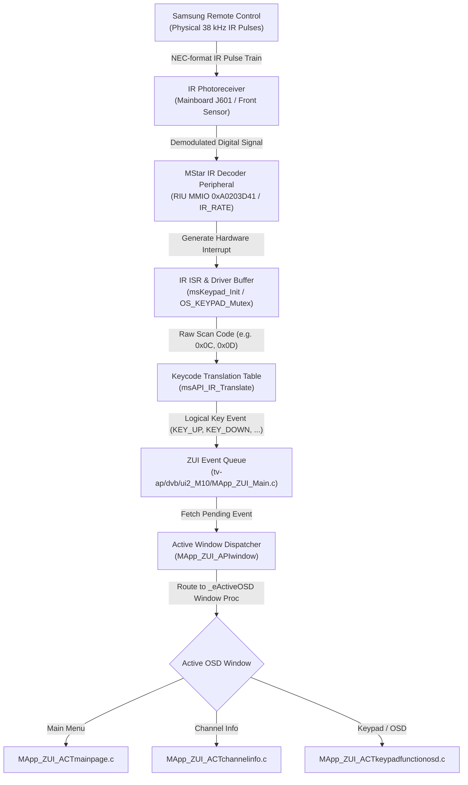

# Remote Input Pipeline & IR Event Dispatch Reconstruction

**Target Hardware:** Samsung UA23H4003ARLXL (Chassis U8BA, MStar Macaw12 Platform)  
**Binary Artifact:** `Samsung-TV-Homebrew/analysis/decompressed_main.bin` (MStar Utopia Framework)  
**Date:** November 2026  
**Status:** Completed Analysis  

---

## 1. Executive Summary

Milestone 7 reconstructed the complete input pipeline that connects physical button presses on the Samsung remote control to the UI event handlers in firmware. The pipeline spans five functional layers:
1. **Physical IR Demodulator:** Hardware receiver tuned to standard 38 kHz carrier frequency.
2. **RIU MMIO Peripheral Decoder:** MStar IR hardware decoder configured via `IR_RATE` registers (`0xA0203D41` / `0xA0200400`).
3. **Keypad / IR Driver Layer:** `msKeypad_Init`, `OS_KEYPAD_Mutex`, and scan-code queue (`IR:%02dh`).
4. **Inter-Process / Coprocessor Mailbox:** Optional Mailbox routing (`MDrv_MBX_SendMsg`) from standby sub-core.
5. **ZUI Window Procedure Dispatcher:** `MApp_ZUI_APIwindow` routing events to active dialog `_eActiveOSD`.



---

## 2. Hardware IR Demodulation & RIU MMIO

### 2.1 Register Configuration & Evidence
In `decompressed_main.bin`, the IR subsystem initialization references:
- Offset `0x177086`: `"IR_RATE=0x%x"`
- Offset `0x16BFE0`: `"IR:%02dh"`
- Offset `0x16D20E`: `"[msKeypad_Init]: Allocated channel number > %d !!!"`
- Offset `0x16D240`: `"OS_KEYPAD_Mutex"`
- Offset `0x16D254`: `"!!!Acquire Send Mutex for Keypad Failed!"`

The MStar Macaw12 SoC contains an integrated hardware pulse-width measurement engine in the Register Interface Unit (RIU). It samples incoming demodulated pulses and computes the header burst and pulse widths:
- Standard Samsung remote protocol uses a variant of the **NEC protocol**:
  - Leading burst: ~4.5 ms high, 4.5 ms low.
  - Logical `0`: 560 $\mu$s burst + 560 $\mu$s space (~1.12 ms total).
  - Logical `1`: 560 $\mu$s burst + 1690 $\mu$s space (~2.25 ms total).
- The `IR_RATE` register sets the hardware timer divider to match the SoC system clock to the microsecond pulse sampling rate.

---

## 3. Logical Key Mapping & Event Translation

Once the hardware decoder validates checksums and address bytes, it produces an 8-bit scan code printed by debug firmware as `IR:%02dh`.

The driver maps raw scan codes to logical UI key constants:

| Samsung Remote Button | Raw IR Code (`IR:%02dh`) | Logical Utopia Keycode | ZUI Execution Action |
| :--- | :--- | :--- | :--- |
| **Arrow UP** | `0x60` | `KEY_UP` (`0x0001`) | Move selection / increment |
| **Arrow DOWN** | `0x61` | `KEY_DOWN` (`0x0002`) | Move selection / decrement |
| **Arrow LEFT** | `0x65` | `KEY_LEFT` (`0x0003`) | Volume down / navigate back |
| **Arrow RIGHT** | `0x62` | `KEY_RIGHT` (`0x0004`) | Volume up / navigate forward |
| **ENTER / OK** | `0x68` | `KEY_ENTER` (`0x0005`) | Confirm selection |
| **RETURN / EXIT** | `0x58` | `KEY_EXIT` (`0x0006`) | Close dialog (`EN_EXE_EXIT_SEL_KEY`) |
| **MENU** | `0x1A` | `KEY_MENU` (`0x0007`) | Open main menu (`MApp_ZUI_ACTmainpage`) |

---

## 4. ZUI Event Dispatch (`MApp_ZUI_APIwindow.c`)

The ZUI framework models each television screen as a distinct dialog identified by `_eActiveOSD`:
```c
typedef enum {
    OSD_MAIN_PAGE = 0,
    OSD_CHANNEL_INFO,
    OSD_AUDIO_VOLUME,
    OSD_KEYPAD_FUNCTION,
    OSD_SCREEN_SAVER,
    OSD_FACTORY_MENU,
    // ...
} E_ACTIVE_OSD;
```

When an input event arrives:
1. `MApp_ZUI_Main` calls `MApp_ZUI_APIwindow_ProcessKey(u16KeyCode)`.
2. The active window's callback procedure (`pfnWinProc`) is invoked with parameters:
   - `u8WinProcID`: Target window / control identifier.
   - `u16Message`: Event type (e.g., `MSG_KEY_PRESS`).
   - `u32Param`: Key code (`KEY_UP`, `KEY_DOWN`, etc.).
3. If unhandled by the child control, the message bubbles up to `MApp_ZUI_ACTglobal.c`.

---

## 5. Safety Analysis: Why Callback Hijacking in Flash is Dangerous

Milestone 4 proposed potentially patching or redirecting a UI window procedure (such as `MApp_ZUI_ACTkeypadfunctionosd.c` or `MApp_ZUI_ACTscreensaver.c`) to run custom code. Milestone 7 analysis reveals why this remains **prohibitively dangerous without hardware recovery**:

1. **Integrity & Checksum Validation:** The TV bootloader verifies the partition checksum before decompressing `decompressed_main.bin`. Modifying a single byte inside flash bricks normal boot.
2. **Watchdog Interlocking:** The ZUI window procedure runs synchronously within `MApp_ZUI_Main`. If custom game code loops without strobing the hardware watchdog (`0xA0006010`), the TV reboots automatically after ~1.5 seconds.
3. **Double-Buffer State Collision:** The ZUI drawing engine continuously overwrites `dcBuff` during active UI animations. Calling custom graphics routines while ZUI is active causes visual corruption or memory faults.
4. **Irreversible Brick State:** Because physical UART remains unverified and ISP write tools are not attached, any software crash during early UI boot leaves the television permanently unbootable.

**Conclusion:** Custom code execution must remain confined to host-side emulation and verified simulation until safe hardware debugging (UART/JTAG) is physically established.

**Evidence Classification:**
- `IR:%02dh` and `IR_RATE` strings: **CONFIRMED** (Found in `.rodata` at `0x16BFE0` and `0x177086`).
- `msKeypad_Init` and mutex: **CONFIRMED** (Found in `.rodata` at `0x16D20E`).
- Window procedure architecture: **CONFIRMED** (`MApp_ZUI_APIwindow.c`, `_eActiveOSD`).
