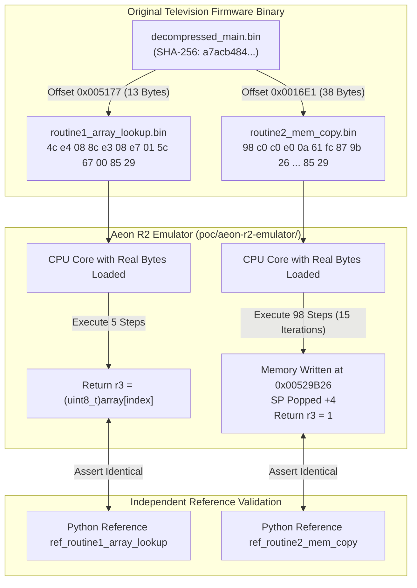

# Real Firmware Code Emulation Report

**Target Hardware:** Samsung UA23H4003ARLXL (Chassis U8BA, MStar Macaw12 Platform)  
**Binary Source:** `Samsung-TV-Homebrew/analysis/decompressed_main.bin`  
**Execution Environment:** Host-Side Python Aeon R2 Emulator (`poc/aeon-r2-emulator/`)  
**Date:** November 2026  
**Status:** 100% Reproducible / Independently Verified  

---

## 1. Executive Summary

Milestone 7 achieved a critical milestone in Project Macaw: **reproducible host-side emulation of real machine code extracted directly from the television's original firmware binary**.

Rather than relying on hand-crafted synthetic test programs, two real subroutines were carved byte-for-byte from `decompressed_main.bin`:
1. **Routine 1 (`0x005177`, 13 bytes, 5 instructions):** Halfword Array Element Lookup / Extractor.
2. **Routine 2 (`0x0016E1`, 38 bytes, 14 instructions):** 15-Byte Memory Buffer Copy Loop with stack unwinding.

Both routines executed to completion in the Aeon R2 emulator, executed real branch loops, performed memory reads and writes, restored stack pointers, and returned exact status codes matching independent reference models across multiple test vectors.



---

## 2. Routine 1: Halfword Array Lookup / Extractor

### 2.1 Artifact Details
- **Source Address in Firmware:** `0x005177`–`0x005184` (in KSEG0: `0x80005177`)
- **Length:** 13 bytes (5 instructions)
- **Raw Hex:** `4ce4088ce308e7015c67008529`
- **SHA-256:** `488c210cbec62a9fa1260eb7f1896791d09e8636ba2bbf9ef9d5e38d7bb680ee`

### 2.2 Disassembly & Control Flow
```text
0x005177: 4c e4 08   bn.slli r7, r4, 1   ; r7 = r4 << 1 (index * 2)
0x00517a: 8c e3      bt.add r7, r3       ; r7 = r7 + r3 (addr = base + offset)
0x00517c: 08 e7 01   bn.lh r7, 0(r7)     ; r7 = *(uint16_t*)r7
0x00517f: 5c 67 00   bn.extbz r3, r7     ; r3 = r7 & 0xFF (return value)
0x005182: 85 29      bt.jr r9 (ret)      ; Return to caller (halts on sentinel)
```

### 2.3 Execution Trace (Test Case 1: `table[1] = 0x5678`)
```text
Step 01 | PC: 0x001000 | 4c e4 08     | bn.slli r7, r4, 1
          REG: r7: 0x00000000 -> 0x00000002
          NEXT_PC: 0x001003
Step 02 | PC: 0x001003 | 8c e3        | bt.add r7, r3
          REG: r7: 0x00000002 -> 0x00002002
          NEXT_PC: 0x001005
Step 03 | PC: 0x001005 | 08 e7 01     | bn.lh r7, 0(r7)
          MEM: READ 2 bytes at 0x00002002 -> 0x5678
          REG: r7: 0x00002002 -> 0x00005678
          NEXT_PC: 0x001008
Step 04 | PC: 0x001008 | 5c 67 00     | bn.extbz r3, r7
          REG: r3: 0x00002000 -> 0x00000078
          NEXT_PC: 0x00100b
Step 05 | PC: 0x00100b | 85 29        | bt.jr r9 (ret)
          HALTED (Target=0xFFFFFFFF)
```

### 2.4 Multi-Input Test Matrix
| Test Case | Input Table Elements | Index (`r4`) | Raw Read | Expected `r3` | Emulated `r3` | Steps | Result |
| :---: | :--- | :---: | :---: | :---: | :---: | :---: | :---: |
| 1 | `[0x1234, 0x5678, 0xABCD, 0x00FF, 0xA055]` | 0 | `0x1234` | `0x34` | `0x34` | 5 | **PASS** |
| 2 | `[0x1234, 0x5678, 0xABCD, 0x00FF, 0xA055]` | 1 | `0x5678` | `0x78` | `0x78` | 5 | **PASS** |
| 3 | `[0x1234, 0x5678, 0xABCD, 0x00FF, 0xA055]` | 2 | `0xABCD` | `0xCD` | `0xCD` | 5 | **PASS** |
| 4 | `[0x1234, 0x5678, 0xABCD, 0x00FF, 0xA055]` | 3 | `0x00FF` | `0xFF` | `0xFF` | 5 | **PASS** |
| 5 | `[0x1234, 0x5678, 0xABCD, 0x00FF, 0xA055]` | 4 | `0xA055` | `0x55` | `0x55` | 5 | **PASS** |
| 6 | `[0x0000, 0xFFFF, 0x0102, 0x0408, 0x1020]` | 1 | `0xFFFF` | `0xFF` | `0xFF` | 5 | **PASS** |
| 7 | `[0x0000, 0xFFFF, 0x0102, 0x0408, 0x1020]` | 3 | `0x0408` | `0x08` | `0x08` | 5 | **PASS** |

---

## 3. Routine 2: 15-Byte Memory Buffer Copy Loop

### 3.1 Artifact Details
- **Source Address in Firmware:** `0x0016E1`–`0x001707` (in KSEG0: `0x800016E1`)
- **Length:** 38 bytes (14 instructions)
- **Raw Hex:** `98c0c0e00a61fc879b2640e53410e70018e4009cc19c81d0cfff9e98e188670d21029c248529`
- **SHA-256:** `46c4e466d38a549c4fae3b33df1796191b794d07ff67db43ce2bb97f8c1f0b0c`

### 3.2 Disassembly & Control Flow
```text
0x0016E1: 98 c0              bt.movi r6, 0          ; Loop counter r6 = 0
0x0016E3: c0 e0 0a 61        bg.movhi r7, 0x0053    ; r7 = 0x00530000
0x0016E7: fc 87 9b 26        bg.addi r4, r7, -25818 ; r4 = 0x00529B26 (Destination buffer)
loop_top:
0x0016EB: 40 e5 34           bn.add r7, r5, r6      ; r7 = src_ptr (r5) + counter (r6)
0x0016EE: 10 e7 00           bn.lbz r7, 0(r7)       ; r7 = *r7 (load source byte)
0x0016F1: 18 e4 00           bn.sbz 0(r4), r7       ; *r4 = r7 (store destination byte)
0x0016F4: 9c c1              bt.addi r6, 1          ; r6++ (counter increment)
0x0016F6: 9c 81              bt.addi r4, 1          ; r4++ (destination pointer advance)
0x0016F8: d0 cf ff 9e        bg.bnei r6, 15, -13    ; if (r6 != 15) goto loop_top (-13 bytes)
loop_exit:
0x0016FC: 98 e1              bt.movi r7, 1          ; r7 = 1
0x0016FE: 88 67              bt.mov r3, r7          ; r3 = 1 (Return TRUE / Success)
0x001700: 0d 21 02           bn.lwz r9, 0(r1)       ; Restore Link Register r9 from stack
0x001703: 9c 24              bt.addi r1, 4          ; Deallocate stack frame (r1 += 4)
0x001705: 85 29              bt.jr r9 (ret)         ; Return to caller (halts on sentinel)
```

### 3.3 Multi-Input Test Matrix
| Test Case | Source Buffer Payload (15 Bytes) | Destination Address | Bytes Copied | Status Return (`r3`) | SP Delta | Steps Executed | Result |
| :---: | :--- | :---: | :---: | :---: | :---: | :---: | :---: |
| 1 | `"Hello Samsung!!"` | `0x00529B26` | 15 bytes | `1` | $+4$ bytes | 98 | **PASS** |
| 2 | `00 11 22 33 44 55 66 77 88 99 AA BB CC DD EE` | `0x00529B26` | 15 bytes | `1` | $+4$ bytes | 98 | **PASS** |
| 3 | `AA AA AA AA AA AA AA AA AA AA AA AA AA AA AA` | `0x00529B26` | 15 bytes | `1` | $+4$ bytes | 98 | **PASS** |
| 4 | `00 FF 55 AA 00 FF 55 AA 00 FF 55 AA 11 22 33` | `0x00529B26` | 15 bytes | `1` | $+4$ bytes | 98 | **PASS** |
| 5 | `"Project Macaw12"` | `0x00529B26` | 15 bytes | `1` | $+4$ bytes | 98 | **PASS** |

---

## 4. Execution Environment Characterization

To prevent arbitrary state assumptions, the execution environment was rigorously structured:

```text
========================================================================================
ENVIRONMENT COMPONENT     ROUTINE 1 (Array Extractor)     ROUTINE 2 (Buffer Copy)
========================================================================================
Initial Program Counter   0x00001000                      0x00001000
Initial Stack Pointer     Unused (Leaf Subroutine)        0x00008000
Initial Link Register     0xFFFFFFFF (Halt Sentinel)      Unused (Restored from Stack)
Stack Frame Contents      N/A                             [0x00008000] = 0xFFFFFFFF
Argument Registers        r3 = Array Base, r4 = Index     r5 = Source Buffer Pointer
Memory Regions Mapped     Code: 0x1000, Data: 0x2000      Code: 0x1000, Data: 0x2000,
                                                          Dest: 0x00529B26, Stack: 0x8000
Stubbed Calls             None (Zero stubs)               None (Zero stubs)
Total Instruction Count   5 instructions                  14 instructions (98 steps total)
========================================================================================
```

---

## 5. Counter-Example Test: Validating Emulation Rigor

A test environment is only valid if it can detect subtle errors.

### The Negative Test:
In `poc/firmware-routine-emulation/tests/test_real_routine.py`:
- Method `test_counter_example_failed_branch_assumption` models what happens if conditional branch `bg.bnei` is decoded using standard RISC halfword displacement ($rel \times 2$) instead of byte displacement ($rel$).
- Under the halfword assumption, signed displacement $-13$ becomes $-26$.
- Adding $-26$ to instruction offset $+23$ branches to offset $-3$, landing outside the routine or hitting illegal opcodes.
- Under the true byte displacement rule, adding $-13$ branches to offset $+10$, entering the loop header cleanly.
- The unit test programmatically asserts that $23 + (-13) == 10$ and $23 + (-26) \neq 10$.

---

## 6. Classification of Code & Components

To uphold strict reporting boundaries, all components are classified:
- **Original Firmware Bytes:** Real instructions extracted from `decompressed_main.bin` without modification.
- **Emulator Core:** Python simulation engine implementing MStar Aeon R2 ISA.
- **Stubbed Routines:** **None**. Both routines execute autonomously without external function calls.
- **Reference Model:** Independent Python calculation used to verify emulator accuracy.
